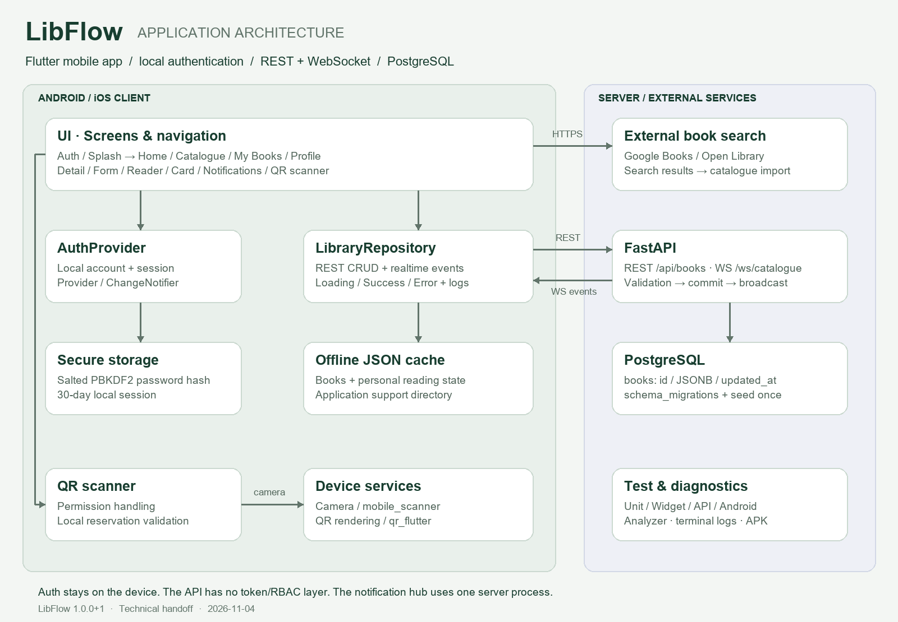

# LibFlow архитектурасы

Векторлық нұсқа: [architecture.svg](architecture.svg).
Диаграмманы қайта жасау: `python scripts/draw_architecture.py` (Pillow қажет).

## Қабаттар

1. **UI:** `main.dart` авторизация gate, тақырып және негізгі навигацияны
   басқарады. Экрандар кітаптар мен callback-тер арқылы жұмыс істейді.
2. **Күй:** `AuthProvider` — аккаунт/сессия; `LibraryRepository` —
   Loading/Success/Error, REST операциялары, кэш және realtime жаңарту кезегі.
3. **Деректер:** `LibraryApiService` — HTTP/JSON; `LibraryDatabaseService` —
   application-support каталогындағы тұрақты JSON файл. Бұл SQLite емес.
4. **Realtime:** `LibraryRealtimeService` — WebSocket, sync/ping/pong,
   connect timeout, heartbeat, retry, dispose. Сервер хабарынан кейін GET жасалады.
5. **Backend:** FastAPI сұрауды Pydantic арқылы тексеріп, параметрленген SQL
   арқылы PostgreSQL JSONB кестесіне жазады. Commit аяқталғаннан кейін hub
   қосылған клиенттерге `catalogue_changed` хабарын жібереді.
6. **Құрылғы:** `ScannerAccess` камера permission күйін басқарады;
   `mobile_scanner` QR оқиды; бронь коды жергілікті кітаптармен салыстырылады.
7. **Диагностика:** `AppLog` операция және қате түрлерін жазады;
   Flutter analyze/tests, PostgreSQL integration tests және Android тесті бөлек орындалады.

## Деректер қоры және шекаралар

PostgreSQL: `books(id TEXT PRIMARY KEY, data JSONB, updated_at TIMESTAMPTZ)`;
`schema_migrations` seed-тің тек бір рет орындалуын қамтамасыз етеді.
Жергілікті файл: кітаптар, авторлар, санаттар, оқырмандар, loans және reviews
кестелерінің JSON көрінісі. Жеке favorite/reservation/loan өрістері REST
payload-тан алынып, GET нәтижесімен біріктіріледі.

`flutter_secure_storage` ішінде аккаунттар мен 30 күндік сессия сақталады.
Пароль: PBKDF2-HMAC-SHA256, 210000 итерация, кездейсоқ salt.
Бұл локалды авторизация; API-ге серверлік login/token/RBAC қосылмаған.
Құрылғыдағы кітап кэші аккаунттарға ортақ. Жалпы каталог редакторы оқу
ортасына арналған; Интернетке жариялауға дайын қауіпсіздік моделі емес.

## API келісімі

| Әдіс | Жол | Мақсаты |
|---|---|---|
| GET | `/health` | API және PostgreSQL диагностикасы |
| GET | `/api/books?q=...` | Каталог/іздеу |
| GET | `/api/books/{id}` | Бір кітап |
| POST | `/api/books` | Кітап қосу (201) |
| PUT | `/api/books/{id}` | Толық жаңарту (200) |
| DELETE | `/api/books/{id}` | Жою (204) |
| WS | `/ws/catalogue` | sync/ping қабылдау, pong/change хабарын жіберу |

Қателер: 404 — жоқ, 409 — қайталанған ID, 422 — валидация, 503 — база.
Hub бір процесс жадында жұмыс істейді; multi-worker үшін ортақ pub/sub қажет.
Сыртқы Google Books/Open Library каталогты іздеуге арналған қосымша көздер.

Ресми анықтамалар: [Flutter integration tests](https://docs.flutter.dev/testing/integration-tests),
[Flutter WebSocket](https://docs.flutter.dev/cookbook/networking/web-sockets),
[FastAPI WebSocket](https://fastapi.tiangolo.com/advanced/websockets/).
